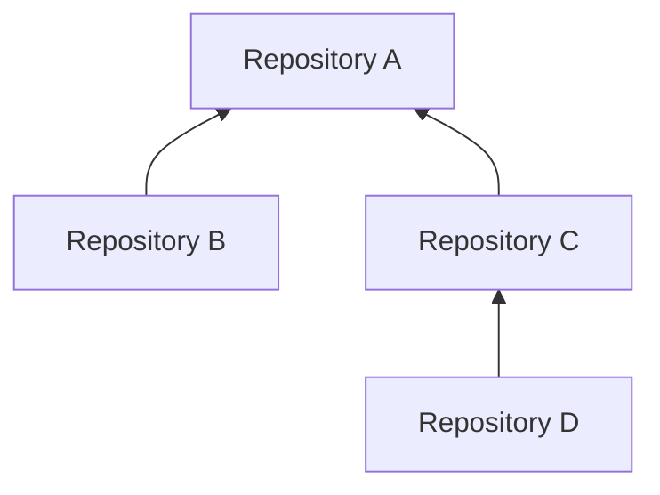

<!-- The Singularity Workshop animated moniker -->
<p align="center"><a href="https://github.com/TrentBest"></a></p>

# Dependency Graph Gates and Cross-Repository Performance

**Status:** Architecture contract and implementation plan. The existing package-dependency release gate, in-plan scheduler, benchmark notice, and local artifact receipt ledger are implemented slices; the complete repository graph gate and remote performance collection protocol are not yet implemented.

## 1. Purpose

CiAi must be able to answer two related questions across an ecosystem:

1. **Can this repository build against the exact current development revisions of everything it depends on?**
2. **How is performance changing across repositories, dependency layers, and the ecosystem as a whole?**

A single repository's green CI result is not sufficient to answer either question. A build is meaningful only for its exact source revision and resolved dependency snapshot. A benchmark is comparable only when its identity, measurement definition, and environment are sufficiently compatible with its baseline.

The model is provider-neutral. GitHub Actions is one possible source of repository and workflow observations, not the domain model or required execution host.

## 2. Repository dependency graph

A repository is a node identified by a canonical, stable repository identity. A directed edge means that a **consumer depends on a provider**. The graph records the edge's purpose and resolution mode; it must not infer that every repository relationship is a package dependency.

### 2.1 Edge kinds

| Edge kind | Meaning | Development gate behavior |
|---|---|---|
| `development-source` | Consumer builds against an upstream repository/project at a declared development source | Resolve and build against an exact upstream commit SHA |
| `published-package` | Consumer uses a package from a named feed | Resolve exact package ID, version, feed, and provenance |
| `source-integration` | A source checkout is used for integration/compatibility proof without becoming a product dependency | Record exact source SHA and the proof that consumes it |
| `test-only` | Dependency is used only by tests | Include when the selected gate profile requires tests |
| `benchmark-only` | Dependency is used to execute or measure benchmarks | Include in the benchmark plan, not automatically in the production build graph |
| `tooling` | Build/documentation/code-generation tool dependency | Include in the applicable toolchain profile |
| `optional` | Capability is optional and guarded by an explicit feature/profile | Include only when that profile is selected |

Each edge has a stable identity, source and target repository identities, edge kind, declared project/package identity, resolution policy, applicable gate profiles, and provenance. An optional edge is never silently treated as required or vice versa.

### 2.2 Example: A depends on B and C; C depends on D

Arrows point from provider to consumer, so they also show the order in which prerequisite evidence flows.



The dependency-first build order is **B, D, C, A** (B and D may build independently and in parallel).

- B can build and report its own result without waiting for A.
- D can build and report its own result without waiting for C.
- C is eligible only after the required D revision has a successful, complete build result and C builds against that exact revision.
- A is eligible only after B and C have qualifying evidence for the resolved revisions, and A builds against those exact revisions.
- If D is stale, missing, failed, or unknown, C is blocked. A is then blocked through the path A → C → D. B remains independently buildable.
- If A fails, that does not invalidate a successful B or D build and does not block unrelated dependents.

This is a dependency gate, not a global build mutex. Work should fan out to independent leaves and converge only at the dependent gate.

### 2.3 Immutable resolution snapshot

A gate begins by resolving the selected graph and all required development branches to full immutable commit SHAs. The resulting snapshot includes:

- graph schema version, graph identity, and deterministic digest;
- candidate repository and full source SHA;
- every transitive dependency repository and full resolved SHA;
- exact project/package identities and edge kinds;
- selected build/test/benchmark profile;
- policy revision and resolution time;
- source attribution for each declaration and resolution.

The build must consume the exact revisions in that snapshot. Checking out a moving `development` branch later in the workflow is not sufficient. The checked-out HEAD for every source dependency must equal the resolved SHA.

A branch can advance while a multi-repository build is running. The result remains reproducible evidence for its original snapshot, but it must be marked **stale relative to the newer development head** when freshness is evaluated again. Do not rewrite the old evidence to pretend it used the new SHA.

### 2.4 Gate outcomes

Keep these states distinct:

- `passed`: required build and evidence completed successfully for the exact snapshot;
- `failed`: a required build or check reported failure;
- `blocked`: a prerequisite is not eligible, with a structured dependency path and reason;
- `stale`: the evidence refers to a revision that is no longer the selected current development revision;
- `missing`: no qualifying evidence exists;
- `incomplete`: discovery or required evidence collection did not finish;
- `skipped`, `cancelled`, `timed-out`, `indeterminate`, and `unknown`: retained as their own outcomes and never promoted to pass.

The report should identify the exact blocking path, for example:

```text
A blocked
└── C blocked
    └── D stale
        ├── required revision: dddddddddddddddddddddddddddddddddddddddd
        └── observed development revision: eeeeeeeeeeeeeeeeeeeeeeeeeeeeeeeeeeeeeeee
```

A green workflow for the wrong SHA is not a green dependency gate. A successful source build is not proof that a published NuGet package exists. A package version is not proof that it was built from the expected source commit.

## 3. Performance evidence across repositories

The performance model must preserve observations, not just a headline number.

### 3.1 Observation identity

Every benchmark observation should bind at least:

- repository identity and full source commit SHA;
- dependency graph snapshot digest, when the benchmark depends on multiple repositories;
- stable benchmark suite and case IDs;
- benchmark tool and version;
- measured statistic (mean, median, p95, throughput, allocation, etc.), value, and unit;
- sample count, warmup/iteration configuration, and dispersion/uncertainty when supplied;
- runtime, framework, OS, architecture, CPU/GPU, and relevant environment fingerprint;
- run/attempt and job identity, evidence URI, and artifact digest;
- baseline identity, baseline source revision, and comparison method;
- measurement and observation timestamps.

Unknown fields remain explicitly unknown. Do not manufacture hardware details or infer a baseline from the latest arbitrary result.

### 3.2 Comparability rules

Two observations may be compared only when their stable benchmark identity and measurement semantics match and their environments satisfy an explicit compatibility policy.

- Normalize units before numeric comparison.
- Do not compare different benchmark cases because their names look similar.
- Do not merge results from materially different hardware/runtime configurations into one unexplained average.
- Keep raw samples or the original report artifact when available; a summary is not a replacement for source evidence.
- Preserve baseline identity and the comparison method.
- Report missing coverage, incomparable observations, regression, improvement, and neutral/no-material-change separately.
- A benchmark result does not become a build pass, package approval, or publication authorization.

### 3.3 Aggregation views

A collector can produce several projections from the same observations:

1. **Repository view:** trend for each benchmark suite/case in one repository.
2. **Dependency-layer view:** compare provider and consumer performance where the benchmark explicitly measures their integration.
3. **Ecosystem view:** summarize coverage, regressions, improvements, and missing/incomparable data across a selected graph snapshot.

An ecosystem-wide score must not hide a critical regression in one package. Always retain drill-down to repository, benchmark case, source SHA, environment, and original evidence.

## 4. Collection point and report envelope

Each repository should produce a self-contained, content-addressed report envelope. The envelope should include a stable report ID, schema version, repository and source identity, graph digest, evidence references, benchmark observations, creation time, and a digest over the canonical payload. Where the transport supports signing or attestations, the collector verifies them against an explicit trust policy.

The collection point is a **host/service concern**, not a static global inside the NuGet library. A provider adapter or repository workflow sends the envelope to a configured collector. The collector:

- validates schema and source identity;
- verifies digest/signature or other configured authenticity evidence;
- deduplicates exact retries by stable identity and digest;
- rejects conflicting reuse of an identity;
- accepts delayed and out-of-order arrivals without rewriting history;
- records receipts and collection time;
- distinguishes no report received from a report that explicitly says failed;
- exposes deterministic machine-readable data and human-readable summaries.

A local append-only receipt ledger is useful for durable local deduplication, but it is not itself a remote multi-repository collection service. Remote persistence, authentication, transport, retention, and query APIs belong to the host/collector implementation.

## 5. NuGet package boundary

The public CiAi domain package must remain usable without GitHub Actions, GitHub REST/GraphQL, workflow YAML, or a particular artifact store.

### Core package responsibilities

- stable repository and package identities;
- typed dependency graph declarations and immutable graph snapshots;
- graph validation, cycle detection, transitive closure, and deterministic topological ordering;
- exact-revision dependency-gate evaluation;
- provider-neutral CI/evidence references and outcome vocabulary;
- benchmark observation, baseline, comparability, and aggregate-report contracts;
- canonical serialization/digest rules where owned by the domain;
- collection envelope and receipt contracts.

### Adapter/host responsibilities

- GitHub Actions API calls, event payloads, workflow/run/job models, and GitHub authentication;
- other CI-provider integrations;
- branch/revision discovery and checkout;
- artifact upload/download and remote collection transport;
- durable remote storage, indexes, dashboards, and notifications;
- scheduling, concurrency, retries, and execution;
- credentials, trust roots, signing keys, and authorization.

**Current portability gap:** the current `TheSingularityWorkshop.CiAi.csproj` includes GitHub-specific implementations such as `GitHubActionsRunClient` and `GitHubActionsBenchmarkDispatchClient` in the same assembly as domain contracts. The intended package boundary is therefore not yet achieved. Move provider-specific implementations into a separately versioned adapter package/assembly while keeping shared contracts in the core. Preserve existing consumer behavior through a deliberate compatibility/migration path and verify both packages using isolated package-consumer tests.

The core package must not require a GitHub token, know the shape of a GitHub workflow YAML file, or assume that GitHub Actions is the execution system. A different provider should be able to supply equivalent evidence through the same provider-neutral contracts.

## 6. Relationship to existing CiAi contracts

This work extends existing implementations:

| Existing contract | Reuse boundary | Remaining gap |
|---|---|---|
| `CiWorkflowPlan` / `CiWorkflowPlanValidator` | In-plan step dependencies, cycle checks, topological order | Repository-to-repository graph and exact upstream source resolution |
| `DependencyReleaseCandidate` / `DependencyReleaseGateEvaluator` | Exact published package requirements and fail-closed release readiness | Development-source graph, transitive freshness, build gate evidence |
| `BenchmarkBuildNotice` / `SuccessfulBuildBenchmarkCoordinator` | Correlate verified successful source build with benchmark trigger | Provider-neutral benchmark result contract and cross-repository aggregation |
| `ArtifactManifest` / `ArtifactReceiptAcknowledgement` | Content identity, digest, provenance, receipt correlation | Canonical ecosystem report envelope and remote collection |
| `FileArtifactReceiptLedger` | Local append-only receipt deduplication and conflict detection | Remote multi-repository persistence/query service |

Do not create a competing plan scheduler, dependency release gate, benchmark notice, or receipt ledger. Add the missing repository graph and aggregate-report capabilities around the existing contracts.

## 7. Implementation sequence

1. **Contract audit and design** — document owners, edge kinds, freshness, evidence semantics, benchmark comparability, and package boundaries.
2. **Provider-neutral graph model** — deterministic validation, cycle detection, transitive closure, and topological plan; offline fixtures for A → B,C and C → D.
3. **Exact dependency evidence evaluator** — bind every node to exact repository/SHA and qualifying build evidence; produce blocking paths and stale/missing/unknown reasons.
4. **Benchmark observation model** — stable case identity, measurement/environment metadata, baseline matching, and incomparable-result handling.
5. **Aggregate envelope and collector contract** — canonical digest, idempotent receipt semantics, out-of-order handling, and deterministic JSON/Markdown projections.
6. **NuGet adapter split** — isolate provider-specific implementations and prove a clean provider-neutral package consumer.
7. **Shadow integrations** — add graph declarations and report production alongside existing repository workflows. Keep existing build/test/package gates authoritative.
8. **Promotion review** — only after exact-SHA graph and aggregate evidence is proven should any dependency gate become a required check. Existing publication authorization remains separate and human-controlled.

## 8. Safety invariants

- A repository can build independently of its dependents.
- A dependent cannot pass against stale or unknown required dependency evidence.
- All dependency checkouts are pinned to full SHAs and recorded.
- Missing, duplicate, ambiguous, incomplete, or mismatched evidence never becomes success.
- Source dependencies and published package dependencies remain distinct.
- Performance comparisons retain their environment and baseline context.
- The collector preserves raw evidence and provenance.
- Core contracts remain provider-neutral; adapters own transport and credentials.
- Existing CI is not replaced or weakened during shadow adoption.
- A green ecosystem build never grants NuGet publication, release, merge, or deployment authority.

## 9. Tracking

Implementation is tracked in [issue #54](https://github.com/TrentBest/TheSingularityWorkshop.CiAi/issues/54). The first evidence-lane rollout remains tracked in [issue #51](https://github.com/TrentBest/TheSingularityWorkshop.CiAi/issues/51). Existing dependency release-gate work remains tracked in [issue #16](https://github.com/TrentBest/TheSingularityWorkshop.CiAi/issues/16).

<p align="center"></p>
