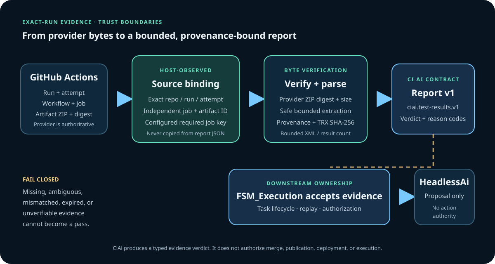

# CiAi test-result evidence contract

**Contract:** `ciai.test-results.v1`  
**Version:** 1  
**Status:** Implemented contract; integration acceptance remains owned by the consuming host.

This page explains the end-to-end trust path for a test-result report. The report is a normalized, bounded statement about one test job in one exact GitHub Actions workflow attempt. It is not a replacement for provider evidence, a general CI verdict, or an authorization receipt.

## 1. Ownership and trust boundaries

| Participant | Owns | Does not own |
|---|---|---|
| GitHub Actions | Authoritative workflow/run/job state and provider artifact metadata | CiAi's normalized contract |
| CiAi producer | Exact-run evidence validation, artifact binding checks, TRX normalization, versioned report | Host authorization or downstream task lifecycle |
| Trusted host / retriever | Independent provider observations, archive download, provider digest verification, safe extraction, accepted-byte identity | Reinterpreting untrusted report fields as provider facts |
| FSM_Execution | Accepted-evidence context, task/lease/replay lifecycle, authorization, governed execution | Producing the original CI verdict |
| HeadlessAi | Consuming bounded accepted context and returning a proposal | Provider authentication, task authorization, or execution |

The core rule is that **report JSON cannot authenticate itself**. In particular, the host-observed artifact-to-job binding is separate from the report and must be constructed from independently observed provider metadata.

## 2. Producer sequence

1. Observe the exact repository, workflow run, attempt, workflow definition, checkout, and jobs.
2. Require trusted workflow-definition and checkout provenance plus complete evidence for the selected run attempt.
3. Independently bind the provider artifact ID/name and archive digest/size to exactly one observed job and the configured required workflow job definition.
4. Download the artifact and verify the provider-reported SHA-256 digest over the ZIP bytes before extraction.
5. Safely extract the expected provenance and TRX payload under archive-entry, size, and path constraints.
6. Validate the provenance payload's own content SHA-256 and its repository/run/attempt/workflow/event/checkout identity against the independently observed run.
7. Validate the TRX payload's exact size and SHA-256, parse it with bounded XML handling, normalize result outcomes, and produce the v1 report.
8. Persist/deliver the report through the host's configured handoff. Consumers must still authenticate the delivery and bind it to the expected task/candidate.

The implementation entry points are `CiTestResultArtifactSource.FromVerifiedProviderObservation`, `CiWorkflowProvenanceRecord.ParseAndValidate`, and `CiTestResultReport.ParseAndValidate`.

## 3. Report identity and contents

The report carries:

- Contract identity: `contractVersion` and `schema`.
- Candidate identity: canonical repository, candidate ref, and full candidate SHA.
- Workflow identity: workflow path, definition ref and SHA, event name/ref/SHA, and any pull-request head/base refs and SHAs.
- Execution identity: run ID, attempt, job ID/name, status, conclusion, and provider evidence URLs.
- Policy context: required-check status, verdict, and stable reason codes.
- Artifact identity: source artifact ID/name, configured source job key, provider ZIP digest/size, artifact creation/expiry, and extracted payload SHA/size.
- Test summary: framework, TRX format, total/passed/failed/skipped/other counts, bounded result records, and observation timestamp.

The parser's default maximum TRX payload is **16 MiB** and the report allows at most **10,000 test results**. Diagnostic messages and stack traces are bounded; recognized credential-like values are redacted. These are parser/report limits, not substitutes for transport-level archive and extraction limits.

### Verdict meanings

| Verdict | Meaning |
|---|---|
| `CompletePass` | The exact required job completed successfully and the validated test result set contains no failing or non-passing outcome that violates the report policy. |
| `ActionableFailure` | Trusted, complete evidence establishes a failed required check with test diagnostics that can guide a bounded repair proposal. |
| `IncompleteOrUntrusted` | Evidence is missing, incomplete, mismatched, expired, or otherwise cannot be trusted as a complete exact-run result. |
| `NonActionableFailure` | A failure is established, but it does not provide a trusted actionable test-diagnostic set for automated repair. |

A consumer must not collapse these values into a boolean. In particular, `IncompleteOrUntrusted` is not a test failure diagnosis, and `NonActionableFailure` is not permission to retry or repair.

## 4. Required host-side checks

Before accepting a report, the host must independently verify:

- The sender and delivery channel are authenticated for the expected repository/task.
- Exact report bytes match the trusted content digest and supported schema.
- Repository, candidate SHA/ref, run ID/attempt, workflow identity, and job identity match the expected task and provider observations.
- Source artifact identity is backed by provider-observed metadata and the exact artifact-to-job association; do not trust a nested binding copied from report JSON.
- The report's verdict is accepted only from the authenticated CiAi producer path and only under the host's configured policy.
- Replay/idempotency handling binds the same key to the same immutable report and source-artifact identity.
- Any ambiguity, stale evidence, mismatch, duplicate identity, incomplete retrieval, or unsupported contract version fails closed.

CiAi's source artifact verifier proves byte and archive consistency within its stated boundary. It does not authenticate the sender or prove that a notice was accepted by FSM_Execution. Those remain host responsibilities.

## 5. Repair handoff and authorization

Only an accepted `ActionableFailure` report with the required source-artifact binding may be supplied as repair context. HeadlessAi may use that context to explain a failure and propose a bounded change. Its response remains untrusted proposal data.

FSM_Execution and the host retain control over candidate identity, leases, replay protection, authorization, validation, and execution. A model-generated statement, tool call suggestion, report field, or successful CI run cannot grant merge, package publication, release, deployment, or command-execution authority.

## 6. Limits and non-goals

This contract does not, by itself:

- Prove the authenticity of an arbitrary sender or webhook.
- Perform provider API retrieval or ZIP downloading inside the report parser.
- Replace GitHub's workflow result or branch-protection policy.
- Define a global CI policy for every repository.
- Authorize repairs, merges, NuGet publication, releases, or deployments.
- Guarantee that a timed-out downstream action has stopped.
- Establish that every test framework or report format is supported; v1 currently normalizes TRX.

## 7. Implementation references

- [Report implementation](../src/TheSingularityWorkshop.CiAi/CiTestResultReport.cs)
- [Workflow provenance implementation](../src/TheSingularityWorkshop.CiAi/CiWorkflowProvenanceRecord.cs)
- [Artifact archive verifier](../src/TheSingularityWorkshop.CiAi/CiTestResultArtifactArchive.cs)
- [Required job policy](../src/TheSingularityWorkshop.CiAi/CiRequiredJobPolicy.cs)
- [FSM_Execution notice enqueuer](../src/TheSingularityWorkshop.CiAi/CiTestResultExecutionNoticeEnqueuer.md)
- [Release readiness and authorization gates](RELEASE_READINESS.md)
- [HeadlessAi accepted CI context](https://github.com/TrentBest/TheSingularityWorkshop.HeadlessAi/pull/13)
- [FSM_Execution accepted CI report integration](https://github.com/TrentBest/TheSingularityWorkshop.FSM_Execution/pull/15)

## 8. Evidence and validation

The contract's regression suite includes provenance binding, malformed and oversized TRX rejection, DTD/external-entity rejection, result-count bounds, diagnostic bounds/redaction, verdict classification, and failure-closed behavior.

For the CiAi PR candidate `5dbdb8cae5ec3ff8375314ef2e56f6ff613c6a19`, the exact authoritative push workflow `43686607144` (attempt 1) completed successfully. Its harness reported 74 individual checks, 109 suite/check records, and zero failed records; the dedicated TRX contract suite reported 52 checks. The exact-source observer `43686607156` also completed successfully, validated the exact source run, and retained JSON, Markdown, and test-result evidence in artifact [`14150977201`](https://github.com/TrentBest/TheSingularityWorkshop.CiAi/actions/runs/43686607156/artifacts/14150977201). Contract Verification PR run `43686610370` and Cog Ecosystem Integration run `43686610334` passed on the same candidate SHA.

These are candidate-specific CI facts, not a statement that the PR is merged, that all ecosystem consumers accept the report, or that publication is authorized. Revalidate the exact head before relying on these results after any subsequent commit.
