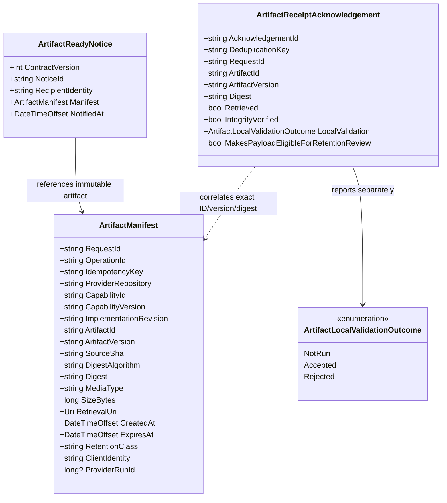
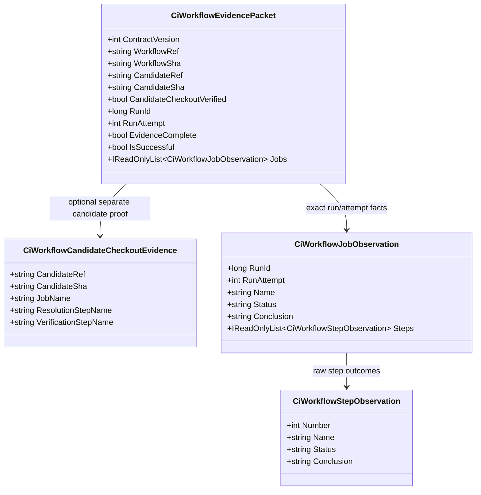
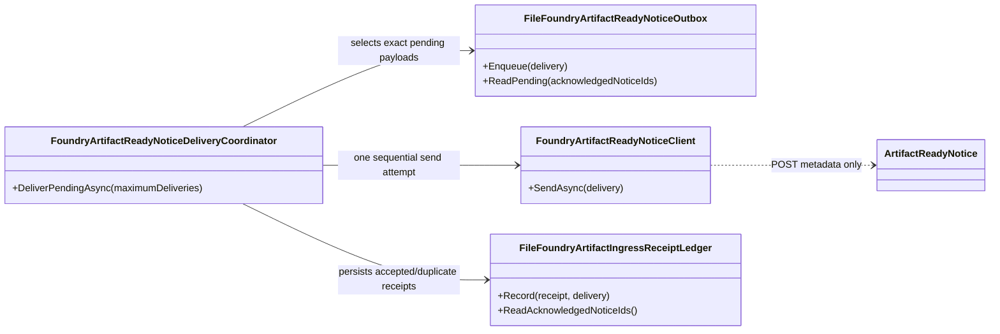

<!-- The Singularity Workshop moniker -->
<p align="center"><a href="https://github.com/TrentBest"></a></p>

# Capability artifact handoff — UML class diagrams and use cases

**User moniker:** Pull Into Your Own Security Blanket

## Artifact notice and receipt contracts



## CiWorkflowEvidencePacket v2 provenance



For an ordinary run, candidate provenance defaults to the workflow event ref/SHA. For trusted-ref dispatch, the workflow runs from `refs/heads/development` and checks out a separate feature-branch candidate. The packet then carries `CiWorkflowCandidateCheckoutEvidence`; `CandidateCheckoutVerified` is derived from the registered job and successful branch-resolution/checkout-verification steps. A later test failure does not erase checkout provenance, but still makes `IsSuccessful` false.

For v2 artifact handoff, `ArtifactManifest.SourceSha` binds to `candidateSha`, while `ProviderRunId` binds to `runId`. Foundry must independently validate `workflowRef/workflowSha` against its trusted workflow registration and candidate fields against the exact task request.

## Sender-side durable notice delivery



## Use case: bounded durable notice delivery

```mermaid
sequenceDiagram
    participant Host
    participant Coordinator
    participant Outbox
    participant Client
    participant Foundry
    participant Ledger
    Host->>Coordinator: DeliverPendingAsync(max)
    Coordinator->>Ledger: ReadAcknowledgedNoticeIds()
    Coordinator->>Outbox: ReadPending(acknowledged)
    loop selected notices, once each
        Coordinator->>Client: SendAsync(exact delivery)
        Client->>Foundry: POST ArtifactReadyNotice metadata
        Note over Foundry: Contract-defined receiver; runtime not deployed
        Foundry-->>Client: 202 accepted / 200 duplicate / error
        Client-->>Coordinator: validated status, receipt, retry metadata
        alt authenticated accepted or duplicate
            Coordinator->>Ledger: Record(receipt, exact delivery)
        else no acknowledgement
            Coordinator-->>Host: keep exact notice pending
        end
    end
    Coordinator-->>Host: batch summary and per-notice outcomes
```

The coordinator attempts at most 100 notices per call (default 20), sequentially. It persists only authenticated `Accepted`/`Duplicate` receipts. Authentication/authorization failures, rate limits, retryable transport failures, and rejected/malformed receiver responses stop the batch; notice-specific invalid requests and conflicts remain visible without blocking independent notices. Retry scheduling and backoff remain host-owned.

## Use case: pull, verify, acknowledge

1. Provider creates an immutable artifact and a validated manifest for a bounded request.
2. Provider sends a small ready notice to the intended client.
3. Client authenticates the provider and checks notice version, request, recipient, expiry, retrieval destination policy, and size limits.
4. Client pulls with read-only access into its own staging area, computes SHA-256, verifies provenance, and runs local checks.
5. Client records and sends an acknowledgement correlated to the exact request, artifact version, and digest.
6. Provider deduplicates the receipt and records it. A separate retention policy decides whether the payload is eligible for reclamation; actual reclamation is recorded only after storage confirms deletion.

## Implementation boundary

Implemented in CiAi: notice/manifest contracts, metadata-only HTTPS sender, durable notice outbox, durable accepted/duplicate receipt ledger, bounded one-pass delivery coordinator, evidence packet v2, and candidate-checkout provenance derivation.

Not implemented: the remote Foundry receiver/JWT validator, immutable remote artifact hosting and retrieval, provider-side acknowledgement transport, automated retry scheduler, and end-to-end Foundry task orchestration. The receiver shown in the sequence diagram is a contract boundary, not a live service. This UML distinguishes implemented sender-side behavior from the future cross-repository handoff.

---

<!-- THE SINGULARITY WORKSHOP FOOTER -->
<p align="center"></p>
