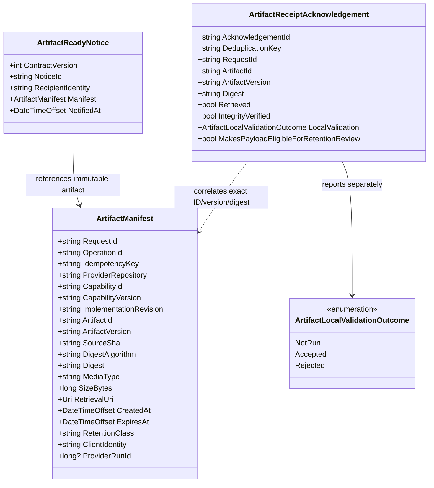

# Capability artifact handoff — UML class diagram and use case

**User moniker:** Pull Into Your Own Security Blanket

## Use case: pull, verify, acknowledge

1. Provider creates an immutable artifact and a validated manifest for a bounded request.
2. Provider sends a small ready notice to the intended client CiAi.
3. Client authenticates the provider and checks notice version, request, recipient, expiry, retrieval destination policy, and size limits.
4. Client pulls with read-only access into its own staging area, computes SHA-256, verifies provenance, and runs local checks.
5. Client records and sends an acknowledgement correlated to the exact request, artifact version, and digest.
6. Provider deduplicates the receipt and records it. A separate retention policy decides whether the payload is eligible for reclamation; actual reclamation is recorded only after storage confirms deletion.

## Implementation boundary

The three types and offline constructor checks exist. Network notification, artifact retrieval, hashing actual payload bytes, provider authentication, durable acknowledgement deduplication, authoritative CI correlation, and retention/reclamation workers do not exist yet. This UML documents the current contract types, not an implemented end-to-end flow.
