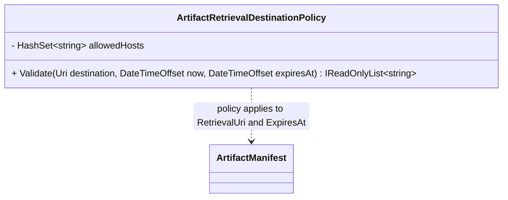
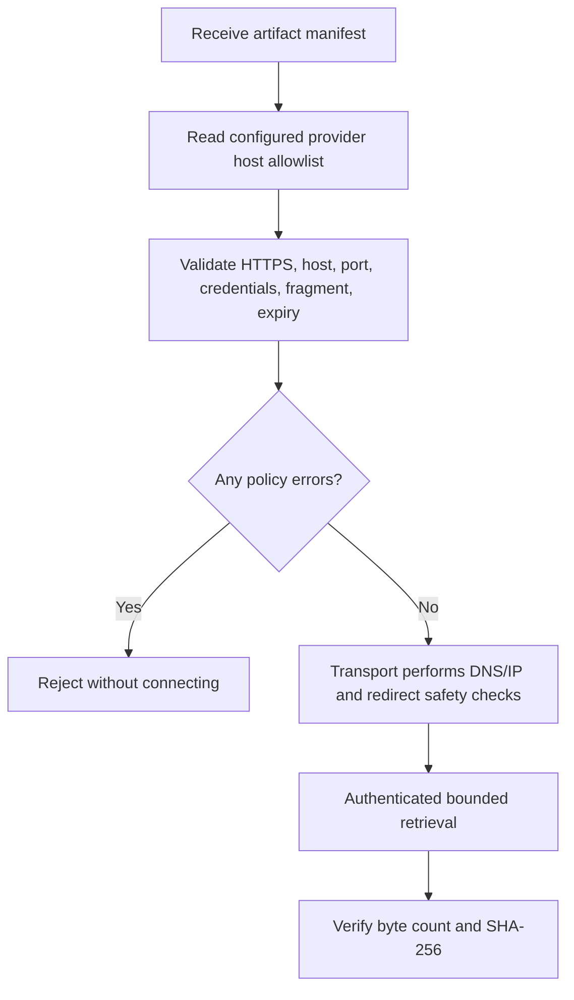

# ArtifactRetrievalDestinationPolicy — UML and Use Case

## Use case: validate a destination before opening a connection

The class is a preflight policy gate only. It does not resolve DNS, perform network requests, authenticate, or make redirects safe. The caller must enforce those controls at the transport boundary.
