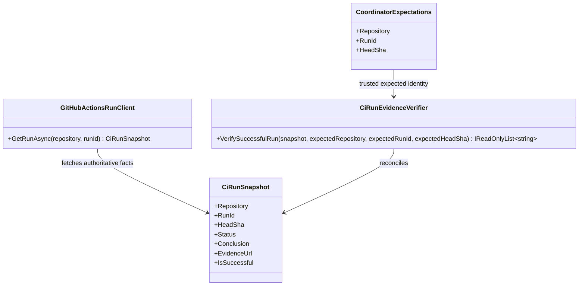

# CiRunEvidenceVerifier — UML and use case

**User moniker:** The Singularity Workshop

## Class diagram

## Use case: read-only run reconciliation

1. The trusted host chooses the expected repository, run ID, and commit SHA.
2. `GitHubActionsRunClient` fetches the run using HTTP GET and creates a validated snapshot.
3. `CiRunEvidenceVerifier` compares the snapshot against the trusted expectations.
4. A mismatch, incomplete run, or conclusion other than success is rejected with stable error codes.
5. Only a zero-error reconciliation may be used as verified evidence for this narrow operation.

This verifier is not dispatch, policy authorization, callback authentication, or a guarantee that every workflow check was appropriate. It verifies identity and provider-reported success for the one run observed.
