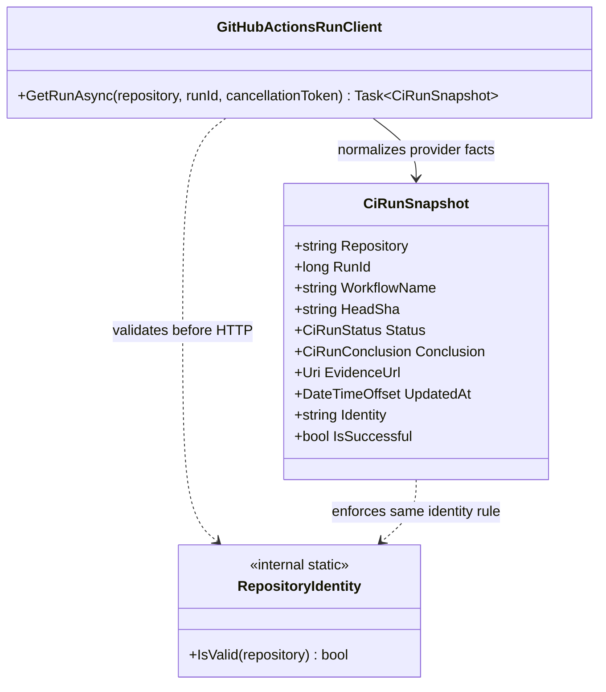

# CiAi read-only CI observation — UML Class Card and Use Case

**User moniker:** Read-only CI Evidence Boundary

## Use case: observe one workflow run

1. A caller supplies a canonical `owner/repository` identity and positive run ID.
2. `RepositoryIdentity` validates the same bounded syntax used by both the HTTP client and snapshot constructor.
3. `GitHubActionsRunClient` performs a read-only GitHub Actions API GET.
4. The client rejects a returned repository or run ID that differs from the request, then validates SHA, status/conclusion consistency, timestamp, and exact HTTPS evidence URL.
5. The caller receives a provider-neutral `CiRunSnapshot`; unknown future conclusions remain unknown and cannot count as success.

## Boundary

This proves observation and normalization of provider facts, not authorization to dispatch work. It does not establish a CogB-to-CogC round trip, authorize a mutating operation, or publish/deploy anything.
