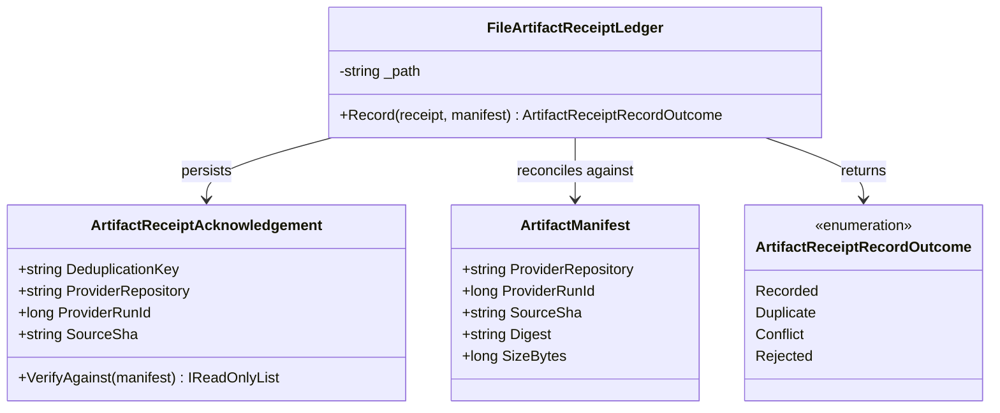

# FileArtifactReceiptLedger UML and Use Case

## Class diagram

## Use case: idempotent receipt recording

1. Client retrieves and verifies a payload separately.
2. Client creates receipt evidence correlated to the provider repository, run ID, source revision, artifact version, and digest.
3. Ledger verifies receipt against the exact manifest before any write.
4. First matching receipt is durably appended and returns `Recorded`.
5. An identical retry returns `Duplicate`; same key with different receipt content returns `Conflict`.
6. Mismatched evidence returns `Rejected` without creating a ledger record.

A recorded receipt is evidence only. It does not trigger provider deletion or imply local acceptance.
