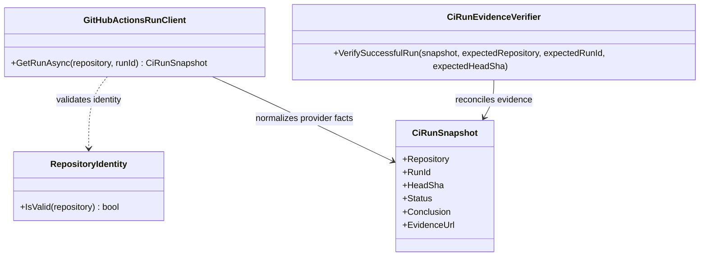

<!-- The Singularity Workshop moniker -->

  

# My CI Was Getting Cumbersome. Then I Saw a New AI Package.

*CiAi began as a practical response to a very ordinary engineering problem: I had more workflows, more repositories, and more evidence to reconcile than I wanted to keep piecing together by hand.*

I wasn't setting out to invent another AI package. I was trying to make my own continuous integration easier to understand.

The Singularity Workshop is a growing line of .NET packages and applications. Their CI has to do more than compile one project: it can build and test code, check public-package compatibility, integrate sibling repositories, run security analysis, and preserve evidence for a particular candidate commit. The more capable the ecosystem became, the more cumbersome the question became:

**What, exactly, did CI prove about this exact commit?**

A green badge is useful. It is not the whole story. Which SHA did the run test? Did every relevant workflow finish? Was a lane skipped, still running, or successful? Did a test exercise the local source graph or the published package a consumer will actually install? Where is the evidence behind the summary?

While working through those questions, I realized the pattern could be a reusable capability—not just a pile of scripts for my own repositories. That was the spark for **CiAi**, the next small “i” in my NuGet package line: *CI exposed to AI*.

The goal isn't to put an AI in charge of CI. It's to make CI's real evidence structured enough that a person or an AI assistant can inspect it without guessing.

## Before: the evidence was there, but I was assembling the story

This is a deliberately sanitized, conceptual illustration—not a dump of private workflow configuration, repository-specific failure details, secrets, tokens, or internal logs.

  

Each workflow can tell the truth about its own run and still leave a bigger coordination job for the developer. I was opening runs, comparing commit identities, checking job and step outcomes, and trying to keep the differences between “passed,” “skipped,” “still running,” and “not observed” straight.

That manual reconciliation is where context gets lost. An assistant can help explain evidence—but if the evidence is scattered or incomplete, it can also confidently explain the wrong thing. I wanted a repeatable contract between the CI provider and the AI-facing layer.

## The shift: keep GitHub Actions in charge; let CiAi organize the evidence

  

CiAi does **not** replace GitHub Actions, run the build instead, or decide that a release should happen. GitHub Actions executes the work and remains authoritative for the results it reports. CiAi observes those results, validates identity, normalizes provider facts, and produces a versioned report that people and AI tools can read.

In this first integration, the report contract is `ciai.commit-observation.v1`. It records the repository and exact head SHA, observed workflow runs, attempt identities, workflow paths, job outcomes, step details, evidence URLs, and discovery coverage. The point is not to make the report look clever. The point is to make its claims traceable.

The boundary is intentional:

- **GitHub Actions executes.** It owns the build, tests, and security workflow.
- **CiAi observes and explains.** It gathers provider-reported evidence and checks that the report refers to the expected repository and commit.
- **The owner authorizes releases.** A report is not permission to publish, deploy, merge, or mutate a repository.
- **An AI assistant reasons from the report.** It can explain, compare, and point out gaps; it must not turn a failed result into success or invent missing evidence.

## The first tangible proof: CiAi observes FSM_COS CI

On October 24, 2026, I connected the observer to the [FSM_COS Pack and publish workflow](https://github.com/TrentBest/TheSingularityWorkshop.FSM_COS/actions/runs/40071136587). The workflow checks out CiAi at a pinned source commit, builds the observer, queries GitHub Actions for the exact FSM_COS candidate SHA, validates the report identity, and uploads JSON and Markdown evidence as an artifact.

**The pilot candidate:** `56ad34dbe4722ba1edf9a4da6a00812eeaa29101`

- [FSM_COS Pack and publish — run 40071136587](https://github.com/TrentBest/TheSingularityWorkshop.FSM_COS/actions/runs/40071136587)
- [CodeQL — run 40071136371](https://github.com/TrentBest/TheSingularityWorkshop.FSM_COS/actions/runs/40071136371)
- [FSM_COS integration commit](https://github.com/TrentBest/TheSingularityWorkshop.FSM_COS/commit/56ad34dbe4722ba1edf9a4da6a00812eeaa29101)
- [CiAi source repository](https://github.com/TrentBest/TheSingularityWorkshop.CiAi)

The build-and-test, public-package compatibility, and source-integration lanes passed, and CodeQL passed on that same commit. The CiAi observer itself built, ran, validated the report identity, and uploaded its artifact. The parent workflow later completed successfully; its NuGet publication job was skipped because the publication guard remains disabled.

One honest wrinkle is worth showing rather than hiding: the first observation artifact was collected while its parent workflow was still in progress. The report recorded that state as it saw it; the parent finished afterward. **A complete observation is not the same thing as a completed workflow, a successful workflow, or release readiness.** A next improvement is to capture final post-run state separately. This first pilot is advisory evidence, not yet a required merge gate.

That limitation is exactly why I want a contract and a report rather than a magic green/red answer. A trustworthy tool needs to preserve what it knows—and what it does not know.

## The UML matters: make the boundary visible

I've been building source-grounded UML and living SVG documentation across the Workshop. That same habit matters here: CiAi shouldn't be a mysterious AI-shaped box. Its responsibilities and hand-offs should be inspectable.

### CiAi's read-only observation path

The existing [CiRunObservation UML class card and use case](https://github.com/TrentBest/TheSingularityWorkshop.CiAi/blob/development/docs/UML/CiRunObservationUML.md) describes the core path: validate repository identity, read a GitHub Actions run, normalize the provider response into a snapshot, and preserve the exact evidence URL. The [CiRunEvidenceVerifier UML](https://github.com/TrentBest/TheSingularityWorkshop.CiAi/blob/development/docs/UML/CiRunEvidenceVerifierUML.md) documents the next boundary: compare observed facts against trusted expectations for repository, run ID, and SHA.

### The larger Workshop uses visual boundaries too

These are existing SVG UML diagrams from FSM_COS, the composition layer being exercised by this pilot. They show the same documentation philosophy: make the boundary and responsibility legible, not just the implementation name.

  

  

Those two diagrams are about FSM_COS, not a claim that they depict CiAi internals. The CiAi class cards above document the observer itself; the FSM_COS diagrams place the integration in the broader architecture. And because these visuals are SVGs served from the repositories, the documentation can evolve with the code instead of becoming a stale screenshot. The animated Workshop moniker at the top is part of that same idea: documentation can be alive.

## What I want CiAi to become

This is the first real integration, not a claim that every Workshop repository is already using CiAi or that release decisions are automated. The next steps are to capture final post-run state, reconcile multiple workflow types for the same candidate, test missing and incomplete evidence paths, and expand the pilot carefully.

The wider opportunity is straightforward: every repository that produces CI evidence shouldn't need to invent its own AI-facing explanation format. A small, reusable NuGet package can help make those facts consistent and consumable—while leaving execution authority with the CI provider and release authority with the owner.

That's the “oh, this could be a thing” moment for me. I started with a practical annoyance in my own engineering workflow. It led to a reusable package idea, a real integration, a versioned evidence contract, and a place for AI to help without asking it to be the source of truth.

> **Let CI execute. Let CiAi explain the evidence. Keep release authority with the owner.**

## Follow the work

- [CiAi repository and README](https://github.com/TrentBest/TheSingularityWorkshop.CiAi)
- [CiAi UML: read-only observation](https://github.com/TrentBest/TheSingularityWorkshop.CiAi/blob/development/docs/UML/CiRunObservationUML.md)
- [CiAi UML: evidence verifier](https://github.com/TrentBest/TheSingularityWorkshop.CiAi/blob/development/docs/UML/CiRunEvidenceVerifierUML.md)
- [FSM_COS integration workflow](https://github.com/TrentBest/TheSingularityWorkshop.FSM_COS/actions/runs/40071136587)
- [CiAi ecosystem CI integration roadmap](https://github.com/TrentBest/TheSingularityWorkshop.CiAi/blob/development/docs/ECOSYSTEM_CI_INTEGRATION_ROADMAP.md)

---

## Editorial status

**Draft for CoderLegion — announcement / attention-getter.** The before/after illustrations are intentionally sanitized conceptual diagrams. Re-check live run states and the SVG embeds immediately before publication. This is an evidence-backed first pilot, not a claim of ecosystem-wide rollout or AI-controlled publishing.

<!-- THE SINGULARITY WORKSHOP FOOTER -->

