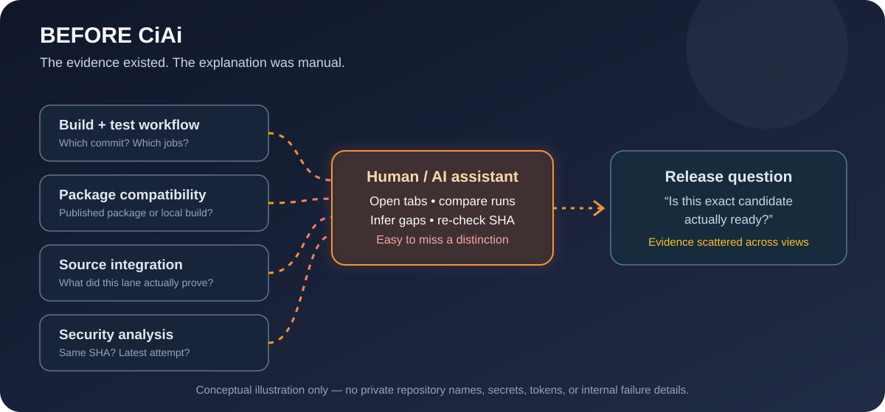
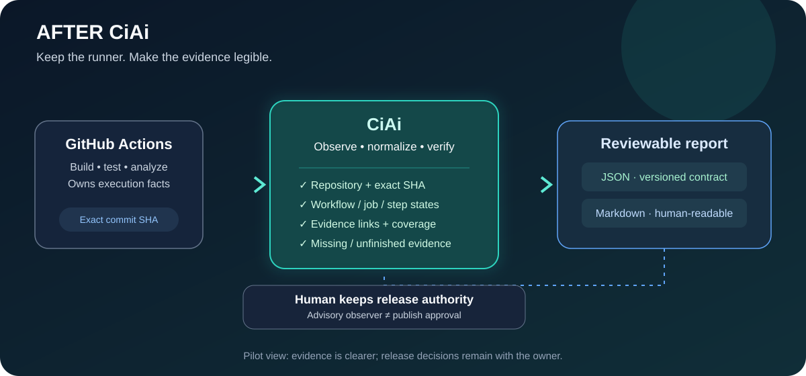

<!-- The Singularity Workshop animated moniker -->

# CiAi: Making a Growing Software Ecosystem Understandable to AI

*How do you help an AI understand a whole workshop of software—without handing it the keys?*

A green checkmark feels good. It tells us that something worked.

But what was it? Was it the latest version of the code? Did all the required tests run? Did they pass, or did the workflow simply finish? And does that green checkmark belong to the application we're interested in—or to a separate process that was only looking at it?

Those details matter.

When a project has one repository and one build, a person can usually keep the story straight. A growing software ecosystem is different. It may contain dozens of repositories, shared libraries, applications, tests, package releases, and automated agents. Each part has its own history and its own view of what happened.

An AI assistant entering that workshop faces a very human problem: **it needs to know which machine did what, which version it worked on, and whether the result can be trusted.**

That is where CiAi comes in.

## First, what is CiAi?

CiAi helps applications and AI systems understand evidence from continuous integration.

Continuous integration, usually shortened to **CI**, is the automation that builds software and runs tests when code changes. GitHub Actions is one system that performs that work and records the results.

CiAi does not replace the build system. It does not build the application for it, and it does not invent a successful result.

Instead, CiAi reads the evidence, checks whether it is complete and belongs to the exact source version under discussion, and presents what it can establish in consistent formats.

Think of it this way:

- **CI does the work.**
- **CiAi checks and explains the evidence.**
- **An application or AI can use that explanation.**
- **The authorized owner or host decides what may happen next.**

The lowercase i in CiAi is intentional. CiAi is not an AI-powered build runner. It is an application-owned information boundary between CI systems and AI.

That boundary matters because an AI should not have to guess what a green checkmark means—and it should not gain authority just because it can read one.

## Why a checkmark isn't the whole story

Imagine walking into a workshop with dozens of machines. Every machine has a status light.

A green light might mean the machine finished its last job. It might mean the job passed inspection. It might even belong to yesterday's job. Unless you know which machine you're looking at, what it was asked to do, and when it did it, the light is not enough to make a decision.

Software builds have the same problem.

A workflow can finish successfully while the tests it was meant to run have failed. A report can be collected successfully even when the application build being inspected failed. A required check might be missing entirely. And a successful run for an older version of the code does not prove that the newest version works.

So CiAi asks a more careful question:

> **What can we prove about this exact version of the software?**

## Every answer needs to point to the right version

A commit is a recorded snapshot of a repository's source code. Its full identifier, called a **commit SHA**, acts like a fingerprint for that particular snapshot.

Why insist on it? Because “the build passed” is incomplete unless we know which source was built. A result from one commit cannot safely be borrowed by another. Even two runs with similar names may refer to different versions, different attempts, or different outcomes.

CiAi starts with a specific repository and full commit SHA. It discovers matching GitHub Actions workflow runs, preserves the identity of each run and attempt, and collects the associated jobs and steps using bounded pagination.

It then produces two views of the same observation:

- **JSON** for software that needs structured data.
- **Markdown** for people who want a readable report.

And it keeps four questions separate:

| Question | What it tells us |
|---|---|
| **Did we find everything?** | Discovery completeness: did the observer finish looking within its configured limits? |
| **Is the evidence present?** | Evidence completeness: did we find the checks that were required? |
| **Is the work finished?** | Terminality: have the relevant workflows reached a final state? |
| **Did it pass?** | Success: did the provider report a successful result? |

These are not four ways of saying the same thing. A workflow may be finished but failed. The observer may have collected every available detail about that failure. A required workflow may not have appeared at all. Sometimes the observer cannot tell whether the evidence is complete.

CiAi keeps those outcomes distinct. When required evidence is missing, duplicated, unfinished, unsuccessful, or incomplete, it fails closed: it reports that the required proof has not been established rather than treating uncertainty as success.

~~~mermaid
flowchart TD
    A["A repository and exact commit"] --> B["CI provider runs the build and tests"]
    B --> C["The provider records runs, jobs, and steps"]
    C --> D["CiAi checks identity and evidence"]
    D --> E["A structured report and a readable report"]
    E --> F["An application or AI uses the facts"]
    F --> G["The host or authorized owner decides what happens next"]
    style D fill:#123a39,stroke:#66e0be,color:#edf7ff
    style G fill:#3a2d18,stroke:#ffd27d,color:#edf7ff
~~~

*The green light is only the beginning. The useful part is knowing what it belongs to and what it actually proves.*

## A workshop needs shared rules, too

Understanding individual builds is one challenge. Keeping a whole ecosystem organized is another.

As repositories multiply, people and automation need predictable answers to basic questions: Where does active work happen? Which branch represents the released version? Which dependencies are being built? Is the repository following the agreed rules—or could we not verify it?

The Workshop uses a convention called the **Sith policy**. An active ecosystem repository should have exactly two permanent branches:

| Branch | In everyday terms |
|---|---|
| **development** | Where active work happens and where new dependency builds begin |
| **master** | The stable, last-released state aligned with published package versions |

This gives everyone a shared map: development is where the project is moving; master is the released reference point.

A release is not just a branch rename or a green build. The intended process brings master into alignment with development, validates the dependency graph and package candidates, and then waits for the owner's explicit authorization before publication.

CiAi's branch-policy workflow reports one of three outcomes:

- **COMPLIANT** — the branch inventory was retrieved and matches the rule.
- **NON-COMPLIANT** — the inventory was retrieved and does not match the rule.
- **UNVERIFIED** — the system could not establish the inventory.

That last result is essential. If GitHub cannot provide the information, CiAi must not pretend the repository is compliant. And reporting a branch-policy problem does not authorize CiAi to delete branches. Cleanup is a separate, deliberate action.

The badge makes that policy visible. Each repository's branch inventory is evaluated and projected into a living SVG badge, with a machine-readable JSON record behind it. Here are two real repository examples from the November 20, 2026 evaluations.

**COMPLIANT — the duel continues**

GrammarAi had exactly the two required branches: `master` and `development`.

**NON-COMPLIANT — the training ground is empty**

FSM_API reported 23 branches in its November 20 evaluation. That is precisely the kind of branch sprawl the policy is intended to make visible.

The underlying `assets/sith-policy.json` record preserves the repository, required and observed branches, branch count, status, evaluation time, workflow run, and triggering commit. If the inventory cannot be retrieved, the badge reports `UNVERIFIED` rather than guessing. The workflow identifies branches that need attention; it does not delete them.

Automation needs both facts and rules for interpreting those facts.

## Five small parts that work together: the Cogs

CiAi is organized around five focused responsibilities called **Cogs**. Think of them as stations in the workshop. Each handles a different part of coordinating work.

| Cog | Its job | The everyday question |
|---|---|---|
| **CogA — Catalog** | Describes repositories, capabilities, versions, and contracts | What is available? |
| **CogD — Policy** | Evaluates whether an operation is permitted for a caller and target | Is this allowed? |
| **CogB — Request** | Creates a bounded request with its inputs pinned | What exactly are we asking for? |
| **CogC — Result** | Checks that a returned result belongs to the request | Is this the answer we asked for? |
| **CogE — Projection** | Presents verified lifecycle facts and diagnostics | What happened, and what do we know? |

The intended flow is straightforward: find a capability, check the rules, make a specific request, verify the response, and present the resulting facts.

The Cogs are designed to be independently testable. Their current integration proof brings the source-pinned components together in one process. It exercises catalog lookup, default-deny policy, bounded request creation, result correlation, artifact and receipt verification, and lifecycle reporting.

That is meaningful progress, but it is not yet a complete networked system. The current proof does not demonstrate a full remote request-and-result journey, authenticated notifications and acknowledgements, or an autonomous agent completing work across repositories.

Being clear about that boundary is part of being trustworthy. It tells us what works today and what still needs to be connected.

## The most important rule: evidence is not permission

Here is the boundary CiAi is designed to protect:

> **Knowing that something happened does not mean you are allowed to make it happen again.**

A report can show that a build passed. It cannot approve a release. A model can recommend a code change. That recommendation does not authorize a merge. A repository can contain instructions for an agent. Those instructions do not grant the agent permissions.

Different parts of the larger system have different jobs:

| Part | Responsibility |
|---|---|
| **GitHub Actions** | Runs workflows and reports what happened |
| **CiAi** | Observes, verifies, correlates, and explains CI evidence |
| **ProtocolAi** | Provides shared protocol vocabulary and identity primitives |
| **GrammarAi** | Checks structure and grammar |
| **HeadlessAi** | Handles model invocation |
| **FSM_Execution** | Orchestrates task acceptance, leases, model turns, authorization, and handoff |
| **Host adapter** | Connects to providers and performs authorized dispatch |
| **Repository owner** | Retains approval over consequential changes and releases |

These boundaries matter because AI systems work with text—and text can be misleading, incomplete, or untrusted.

CiAi includes an **AgentOnboarding admission contract**. It checks a repository's root-level AgentOnboarding.md against the exact commit being evaluated. It validates the source identity, document structure, size limit, and content digest, then returns a deterministic eligibility result with a machine-readable reason when validation fails.

In plain language, it checks that the onboarding instructions are the expected document from the expected version of the repository.

But passing that check does not make the document an authority. The document can explain how to approach a repository; it cannot grant permissions, override host policy, or approve a merge.

The host must retrieve the document from the exact commit and report which commit it actually read. FSM_Execution must enforce the admission result before accepting work and before later autonomous turns or mutations. The validator exists, but that complete runtime enforcement is still being integrated. CiAi does not currently own a live autonomous-dispatch path.

This is how the system can become more capable without quietly becoming less safe.

## A real application puts CiAi to work: AnyApp

An architecture becomes more convincing when another application can actually use it.

**AnyApp is CiAi's first source-based consumer pilot.** AnyApp has its own .NET desktop application and its own GitHub Actions build and test workflow. CiAi does not take over that workflow. AnyApp's existing workflow remains the authority that builds and tests the application.

Instead, the integration lets CiAi observe the result for the exact AnyApp commit. It waits for the authoritative workflow to finish, matches the full commit SHA and run attempt, checks out CiAi at a pinned source revision, and runs the read-only observer. The resulting JSON and Markdown reports are uploaded as evidence. The token is limited to read-only Actions and contents access.

Here are the two runs from the first verified observation:

- [CiAi consumer evidence run](https://github.com/TrentBest/AnyApp/actions/runs/41281306728)
- [Authoritative AnyApp workflow run](https://github.com/TrentBest/AnyApp/actions/runs/41281306660)

The example is especially useful because it did **not** end with a successful application build.

For AnyApp commit **4d40f584fa4011179a731962afdd755fa85e8063**, CiAi successfully collected evidence from the authoritative workflow. The observer's own workflow completed successfully. But the AnyApp build-and-test workflow it inspected had failed two integration tests before executable publishing.

CiAi reported exactly that:

- It completed discovery.
- It found the required evidence.
- The observed workflow had finished.
- The observed workflow had **not** succeeded.
- The required-workflow evidence state was **failed**, not passed.

That is the behavior we want. The observer succeeded at observing. The application workflow failed its tests. Those two facts can both be true at the same time.

Without that distinction, someone might see a green check beside the observer workflow and mistakenly assume the application itself passed. CiAi keeps the identity of the observed workflow visible, so one success cannot be mistaken for another.

It is a modest first integration, but it demonstrates something important: another application can use CiAi to get a more precise account of its own development evidence.

## See the idea, not just the explanation

A system like this should be understandable by looking at it, not only by reading about it.

The [interactive CiAi experience](../../index.html) is a companion introduction. It walks through the path from a CI provider to evidence verification and lets visitors explore complete-evidence and missing-evidence scenarios.

One important note: the browser walkthrough uses clearly labeled illustrative data. It does not connect to GitHub and does not claim to show live build results.

There are several ways to see CiAi, and each has a different purpose:

- **The interactive page** introduces the ideas.
- **The source code and tests** define the actual behavior.
- **GitHub Actions runs and artifacts** provide execution evidence.
- **The AnyApp integration** demonstrates another repository consuming the observer.

The next evolution of this living picture is to connect more of it to verified source facts: repository relationships, exact dependency revisions, branch-policy states, workflow evidence, and the lifecycle of cross-repository requests.

A visualization should never invent a green light. It should make successful, failed, missing, contradictory, and unknown states visibly different.

That is what turns a picture into a useful instrument.

## What works today, and what is still ahead?

CiAi is a growing set of evidence and coordination building blocks. It is not yet a finished autonomous development platform.

**Implemented and exercised today**

- Read-only GitHub Actions observation for a repository and exact full commit SHA.
- Matching workflow-run discovery with attempt identity and bounded job/step collection.
- JSON and Markdown reports with fail-closed handling of incomplete required evidence.
- Provider-neutral run snapshots and exact identity reconciliation.
- Typed artifact, ready-notice, receipt, and payload-integrity contracts, including bounded stream reading and a local durable receipt ledger.
- Standalone CogA–CogE contract slices and a source-pinned, in-process integration proof.
- Exact-commit AgentOnboarding document validation.
- An AnyApp consumer pilot demonstrating source-pinned, read-only evidence collection against a real application workflow.

**Still being built, or intentionally owned elsewhere**

- A complete authenticated remote request/result lifecycle.
- Provider-side artifact retrieval and end-to-end authoritative correlation for remote handoffs.
- Durable cross-repository notification, acknowledgement, replay, and idempotency.
- FSM_Execution runtime enforcement of onboarding admission and task authorization.
- Live HeadlessAi-driven autonomous dispatch through a host adapter.
- A complete end-to-end CI policy system connecting repository-defined checks to provider-hosted execution.
- Any CiAi-controlled authority to publish or deploy.

The current package candidate is **TheSingularityWorkshop.CiAi 0.1.0-alpha.1**. It targets .NET 8 and has no external dependencies in its core library. CI has exercised its build, contract checks, package creation, and isolated package-consumer validation.

That makes it a package candidate—not a published package. A successful workflow does not authorize publication. Publishing remains a separate decision for the owner.

This distinction is intentional. An evidence report can inform a decision. A policy evaluator can say whether a bounded operation is eligible. A model can suggest a change. None of those things should silently become permission to merge, publish, deploy, or delete.

## Where this can lead

Imagine an ecosystem where an AI assistant can enter any repository and quickly answer:

- What is this repository responsible for?
- Which version am I looking at?
- What does it depend on?
- What checks were supposed to run?
- What actually ran, and what did the results say?
- What is missing or uncertain?
- What am I allowed to do—and who must approve the next step?

That is the larger direction.

A growing software ecosystem should not require an AI to guess how it works. Each repository should be able to expose what it provides, what it consumes, which source revision is under discussion, what evidence supports its current state, and which actions remain outside the agent's authority.

CiAi is one part of making that possible: a common evidence boundary that lets applications and AI systems understand development without confusing observation with control.

The goal is not to give an AI a bigger button.

**The goal is to help it understand the workshop before anyone decides whether it should touch a machine.**

Let CI do the work. Let CiAi explain the evidence. Let the host enforce the rules. Keep consequential authority with the owner.

---

## Want to explore further?

- [Try the interactive CiAi experience](../../index.html)
- [Explore the CiAi source repository](https://github.com/TrentBest/TheSingularityWorkshop.CiAi)
- [Read the implementation overview](../../README.md)
- [Browse the CiAi Gallery and proof links](../../Gallery.md)
- [Learn how Cogs and capability providers fit together](../COGS_VS_CAPABILITIES.md)
- [Read the AgentOnboarding admission contract](../AGENT_ONBOARDING_ADMISSION_V1.md)
- [Follow the AnyApp consumer walkthrough](../Samples/AnyApp.md)
- [Review release readiness and the publication boundary](../RELEASE_READINESS.md)

---

<!-- THE SINGULARITY WORKSHOP FOOTER -->

