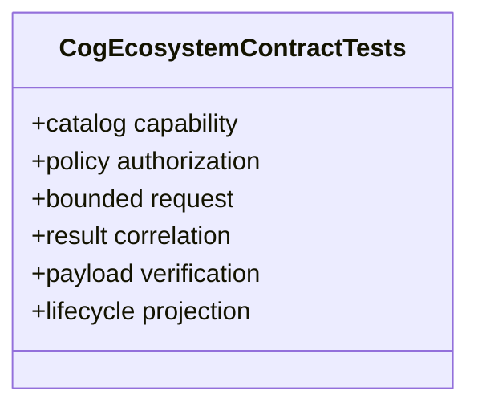

# Cog Ecosystem Contract Tests

**Owner moniker:** The Singularity Workshop  
**Purpose:** prove cross-package contract mapping across CogA–CogE and parent CiAi without network side effects.

## UML class card

The executable integration scenario is in [Program.cs](Program.cs). The runner verifies each control-plane step in order and fails fast on an identity, authorization, integrity, or lifecycle invariant violation.
