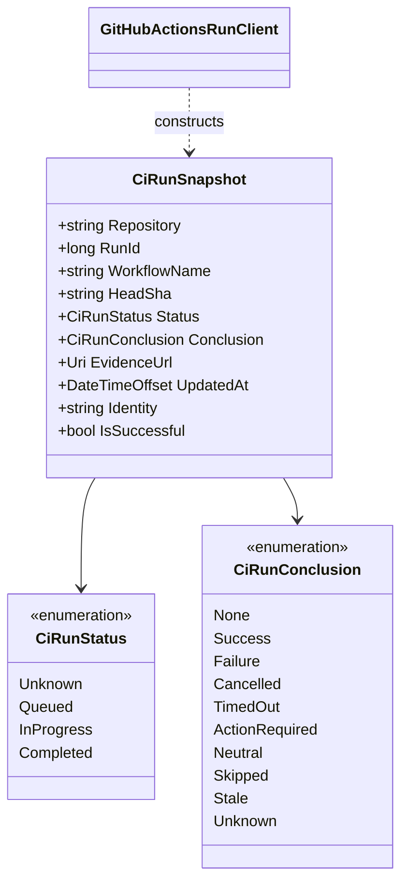

# CiRunSnapshot — UML and Use Cases

## Class diagram

## Use cases

- Normalize a provider response into a typed, immutable observation.
- Reject mismatched repository/run evidence, malformed full commit SHA, and inconsistent status/conclusion combinations.
- Let callers ask whether a run succeeded without interpreting arbitrary provider strings.
- Preserve unknown future conclusions without accidentally treating them as success.

This diagram describes the current source contract. It does not imply dispatch, authorization, LLM invocation, or GUI integration.
