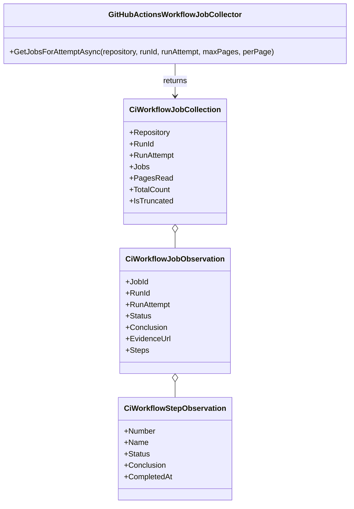

# GitHubActionsWorkflowJobCollector

**Owner:** The Singularity Workshop  
**Purpose:** Collect read-only job and step outcomes for one exact GitHub Actions run attempt.

## Contract

- Uses the attempt-specific GitHub Actions jobs endpoint; retries are never blended implicitly.
- Preserves job IDs, run ID, attempt, names, raw status/conclusion, evidence URL, and ordered step facts.
- Validates any returned run ID and attempt against the requested values and validates each job URL against the canonical repository and job ID.
- Bounds pagination to 1–10 pages and 1–100 jobs per page; `IsTruncated` explicitly signals incomplete discovery.
- Does not reinterpret skipped steps as successful or map workflow/job names to release categories. Those are report-layer decisions.
- Performs HTTP GET only. It does not dispatch or rerun workflows, write checks, modify refs, or publish packages.

## UML / Use case

**Use case:** Given a workflow run ID and an explicit attempt number discovered by the workflow-run collector, retrieve that attempt's jobs and step diagnostics. Keep raw provider facts intact for a deterministic report layer.
