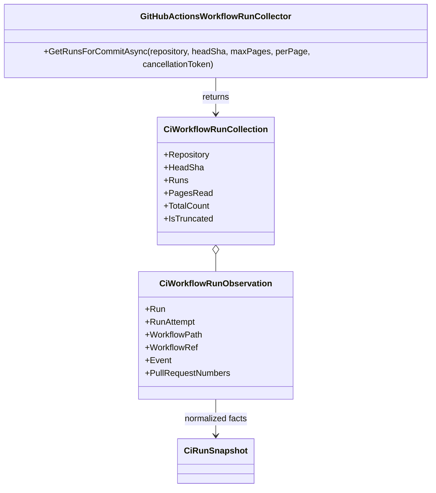

# GitHubActionsWorkflowRunCollector

**Owner:** The Singularity Workshop  
**Purpose:** Read-only, bounded discovery of GitHub Actions workflow runs for an explicitly selected repository and full commit SHA.

## Contract

- Sends GET requests to GitHub's workflow-run collection endpoint with an explicit `head_sha`, page size, and page.
- Independently validates the returned repository and exact full SHA on every row.
- Preserves run ID, retry attempt, workflow name/path, workflow-definition ref (when GitHub supplies the path suffix), event, PR numbers, status, conclusion, update time, and evidence URL. Workflow-definition ref is kept separate from the run's head SHA.
- Does not collapse repeated run IDs or attempts; callers must reconcile retries deliberately.
- Bounds requests to 1–10 pages and 1–100 rows per page. `IsTruncated` means discovery is incomplete and cannot support a complete release report.
- Unknown workflow statuses, malformed provider data, mismatched repository/SHA, invalid attempts, and inconsistent lifecycle fields fail closed.
- Uses only HTTP GET. It does not dispatch workflows, write check-runs, modify refs, or publish packages.

## UML / Use case

**Trust boundary:** For a `workflow_dispatch` candidate run, the workflow path suffix identifies the workflow-definition ref (for example `refs/heads/development`); the run's `head_sha` remains the commit associated with the run. Consumers must not infer candidate SHA from the workflow-definition ref. Missing workflow-ref suffix remains explicit as null; `CiWorkflowEvidencePacket.FromCollections` fails closed until a trusted source supplies the workflow-definition ref.

**Use case:** An operator supplies `TrentBest/TheSingularityWorkshop.FSM_COS` and a full candidate SHA. CiAi discovers only runs for that exact SHA, validates every returned record, reports whether discovery was truncated, and leaves release authorization with the owner.
