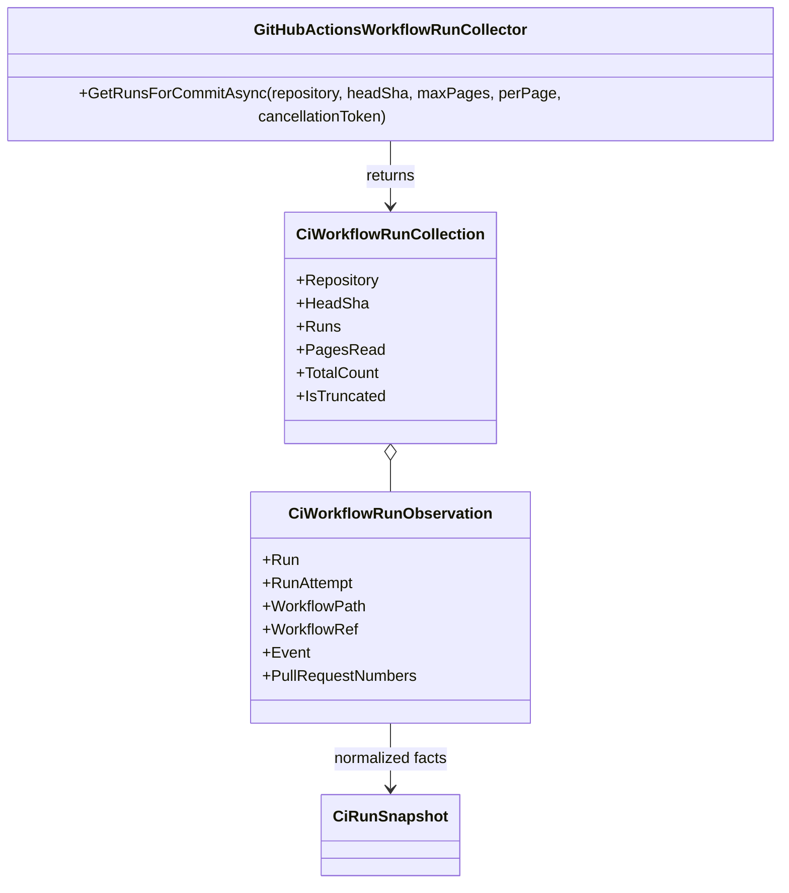

<!-- The Singularity Workshop moniker -->

# GitHubActionsWorkflowRunCollector

**Owner:** The Singularity Workshop  
**Purpose:** Read-only, bounded discovery of GitHub Actions workflow runs for an explicitly selected repository and full commit SHA.

## Contract

- Sends GET requests to GitHub's workflow-run collection endpoint with an explicit `head_sha`, page size, and page.
- Independently validates the returned repository and exact full SHA on every row.
- Preserves run ID, retry attempt, workflow name/path, the workflow-path ref suffix when present, event, PR numbers, status, conclusion, update time, and evidence URL. The legacy path suffix is only a ref hint: it is not the full `github.workflow_ref` value and does not provide `github.workflow_sha`.
- Does not collapse repeated run IDs or attempts; callers must reconcile retries deliberately.
- Bounds requests to 1–10 pages and 1–100 rows per page. `IsTruncated` means discovery is incomplete and cannot support a complete release report.
- Unknown workflow statuses, malformed provider data, mismatched repository/SHA, invalid attempts, and inconsistent lifecycle fields fail closed.
- Uses only HTTP GET. It does not dispatch workflows, write check-runs, modify refs, or publish packages.

## UML / Use case

**Trust boundary:** This collector discovers run metadata only; it does not download or validate provenance artifacts. Its workflow-path suffix may identify a ref such as `refs/heads/development`, but it is not sufficient workflow-definition provenance and must not be promoted to a trust verdict. The trusted host must retrieve the exact run-attempt provenance artifact, verify the provider ZIP digest, safely extract the expected JSON, compute its content digest, and parse it with `CiWorkflowProvenanceRecord`. `CiWorkflowEvidencePacketV3.FromCollections` uses that validated full workflow ref/SHA and does not depend on the legacy path suffix. The v2 factory remains a compatibility path only.

**Use case:** An operator supplies `TrentBest/TheSingularityWorkshop.FSM_COS` and a full candidate SHA. CiAi discovers only runs for that exact SHA, validates every returned record, reports whether discovery was truncated, and leaves release authorization with the owner.

---

<!-- THE SINGULARITY WORKSHOP FOOTER -->

